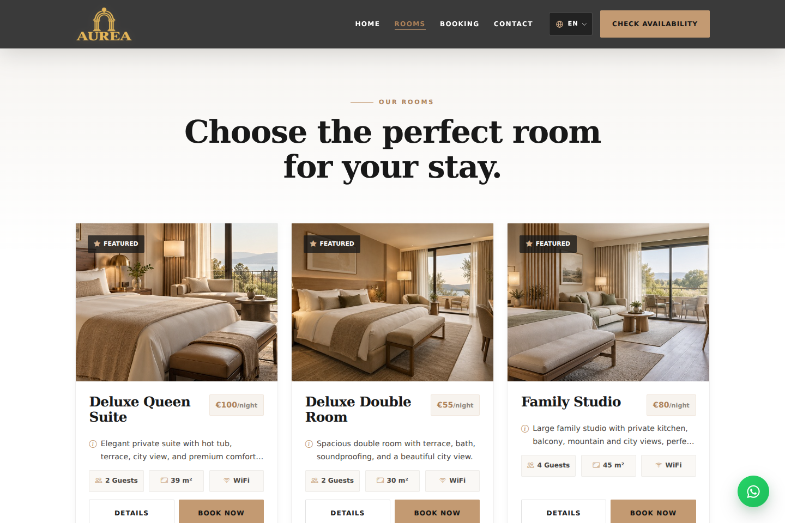
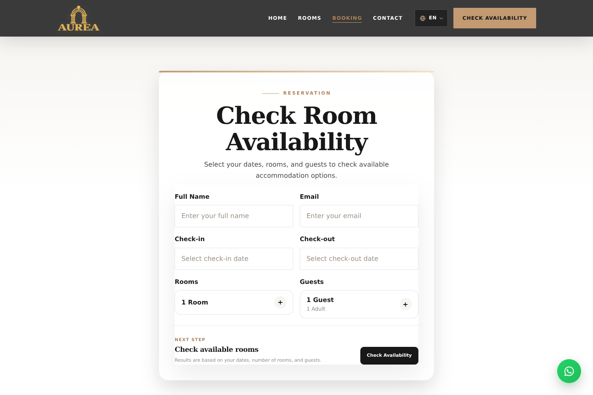
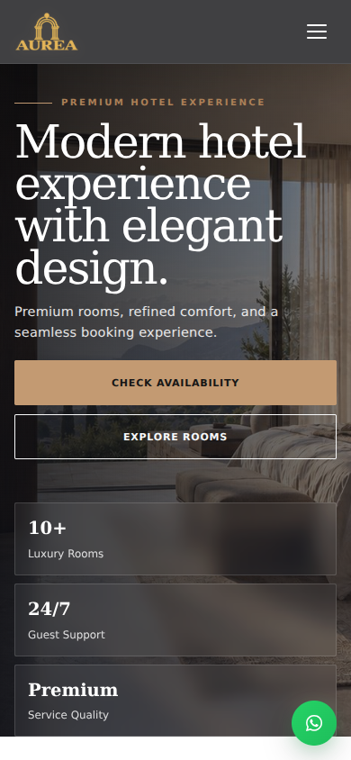
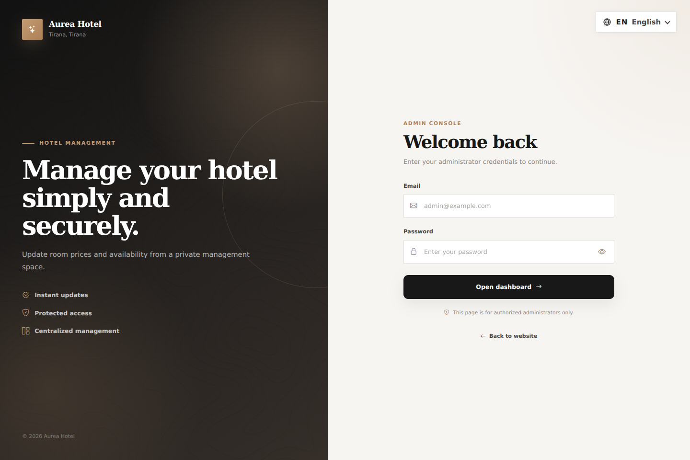
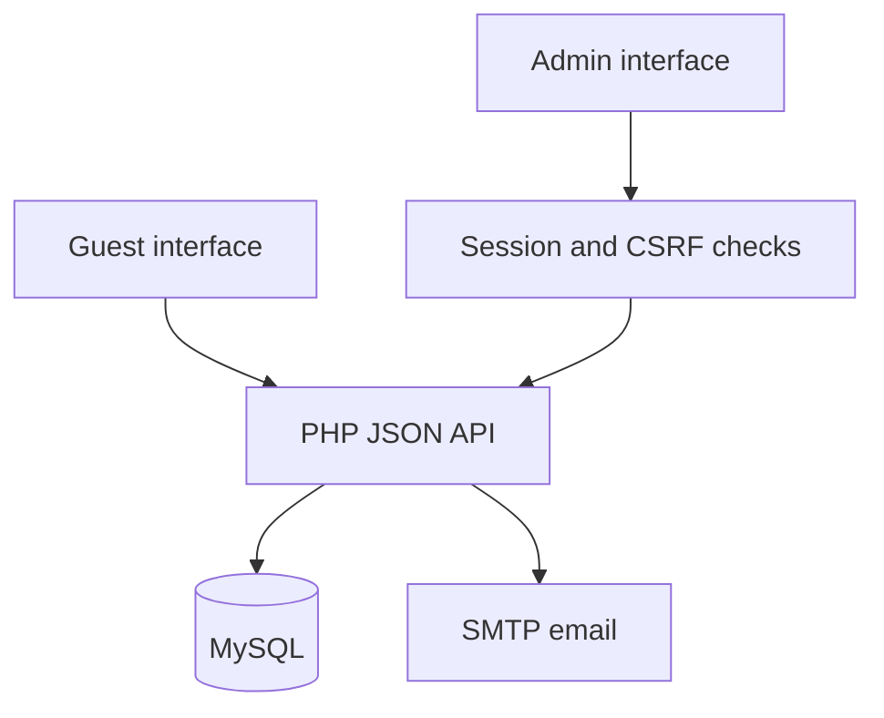

# Aurea Hotel — Booking & Administration Platform

A hotel website that connects room discovery, availability searches and booking requests with an authenticated administration interface.

Built by **Era Hidaj** with React, Vite, PHP and MySQL. This repository is a sanitized portfolio edition: contact details and deployment URLs are placeholders, and the included database inventory is synthetic.


## Product scope

Guests can explore four room categories, inspect photo galleries, search for availability and submit a reservation request. Staff can sign in, manage room prices and availability, review booking requests and update their status.

Bookings start as **pending requests**. The project does not process payments or provide an instant, guaranteed reservation.

## Features

- Responsive guest pages: home, rooms, room details, booking and contact.
- English, Albanian and Italian language selection, persisted locally.
- Date-based availability queries against confirmed bookings.
- Form validation with React Hook Form and Yup, plus server-side booking validation.
- Booking totals calculated from database prices rather than client-submitted totals.
- Admin login with password hashing, failed-attempt lockout and session expiry.
- Server-side authorization and CSRF checks for protected administrative updates.
- Booking status filtering, summary counts and administrative notes.
- SMTP contact messages and booking-status notifications through PHPMailer.
- Page metadata, canonical URL templates, structured hotel data and sitemap files.

## Interface preview

These are captures of the local application. No authenticated customer or booking data is shown. API-dependent actions require the backend described below.

| Room discovery | Booking request |
| --- | --- |
|  |  |

| Mobile homepage | Admin sign-in |
| --- | --- |
|  |  |

## Technology

| Layer | Implementation |
| --- | --- |
| Interface | React 19, JavaScript modules, React Router 7 |
| Tooling | Vite 8, ESLint 9, npm lockfile |
| UI | Bootstrap 5, React Bootstrap, custom CSS, Bootstrap Icons |
| Forms | React Hook Form, Yup, React Datepicker |
| API | PHP 8.2+, JSON endpoints |
| Storage | MySQL / compatible MariaDB, PDO prepared statements |
| Authentication | PHP sessions, password hashes, CSRF tokens |
| Email | PHPMailer 7 over SMTP |
| Automation | GitHub Actions for frontend lint/build and PHP syntax checks |

## Architecture

React owns navigation, presentation, translations and form state. JSON endpoints validate requests and handle database access. Static room descriptions and images live in the frontend; prices and availability come from MySQL when the API is reachable. SMTP credentials remain exclusively on the server.



```text
frontend/
  src/pages/            Guest-facing pages
  src/admin/            Admin routes, screens and API client
  src/components/       Shared layout and UI components
  src/context/          Language provider and hook
  src/data/             Room content and translations
  src/services/         Guest API client
backend/
  api/                  Public, auth and admin endpoints
  config/               Environment, database, CORS and session setup
  database/schema.sql   Synthetic local-development schema
  scripts/              Local admin creation utility
docs/                   Setup, review notes and screenshots
.github/workflows/      Source validation
```

## Run locally

### Requirements

- Node.js **24** and npm.
- PHP **8.2+**, Composer 2, PDO MySQL and OpenSSL extensions.
- A local MySQL or MariaDB server. XAMPP is suitable on Windows.

### 1. Configure the environment

Copy `frontend/.env.example` to `frontend/.env` and `backend/.env.example` to `backend/.env`. On Windows PowerShell, from the repository root:

```powershell
Copy-Item frontend/.env.example frontend/.env
Copy-Item backend/.env.example backend/.env
```

Fill in your local database credentials in `backend/.env`. The frontend value should remain:

```dotenv
VITE_API_URL=http://localhost:8000/api
```

**Every `VITE_*` variable is public browser configuration. Never put passwords, private API keys or SMTP credentials there.**

### 2. Prepare a disposable database

Create an empty database named `aurea_hotel_demo`, using `utf8mb4`. Import `backend/database/schema.sql` through phpMyAdmin's **Import** tab or your MySQL client. Use a local database account with access to that database, then set its credentials in `backend/.env`.

The schema was reconstructed from the source queries because no original database export was provided. It contains four synthetic room records and no guests or admin accounts. **Do not import it into an existing production database.**

### 3. Start the backend

```sh
cd backend
composer install
php scripts/create-admin.php
php -S localhost:8000 dev-router.php
```

The admin utility prompts for an email and a password of at least 12 characters. Its password input is visible in the local terminal; do not record or share that terminal. The database stores only the password hash. No default credentials are published.

The local router exposes only PHP endpoints under `/api/`. Use it instead of serving the complete backend directory without a router.

### 4. Start the frontend in another terminal

```sh
cd frontend
npm ci
npm run dev
```

Open `http://localhost:5173`. Admin sign-in is at `/admin/login`. Use `localhost` consistently in both URLs so session cookies behave consistently.

### Email setup

Set the `MAIL_*` values in `backend/.env` to a development SMTP service or an account you control. Use test recipients while reviewing notification flows. Contact sending and status emails require working SMTP; browsing and database-backed booking requests do not require SMTP.

## API overview

All paths below are relative to `VITE_API_URL`.

| Method | Endpoint | Purpose |
| --- | --- | --- |
| GET | `/rooms.php` | Room prices and enabled state |
| POST | `/availability.php` | Availability for dates and requested rooms |
| POST | `/create-booking.php` | Create a pending booking request |
| POST | `/contact-mail.php` | Send a contact message |
| POST | `/auth/login.php` | Start an admin session |
| GET | `/auth/me.php` | Read the current session |
| POST | `/auth/logout.php` | End the session |
| POST | `/admin/update-room.php` | Change price or availability |
| GET | `/admin/bookings/list.php` | List/filter bookings and counts |
| POST | `/admin/bookings/update-status.php` | Update status and notes |

Admin requests use cookies; protected updates include `X-CSRF-Token`. The server enforces authorization independently of React route protection.

## Validation and current limits

Run locally:

```sh
cd frontend
npm run lint
npm run build
```

The prepared portfolio edition passes these checks. GitHub Actions is configured to repeat them and check PHP syntax; a workflow configuration is not a claim that remote CI has already passed.

The following boundaries are intentional and visible to reviewers:

- PHP, MySQL and SMTP integration were not executed in the preparation environment. The reconstructed schema and admin utility need local integration verification.
- This repository has no automated end-to-end or database integration test suite yet.
- Availability search counts confirmed bookings; booking creation stores a pending request. Inventory is not atomically revalidated and locked when confirming requests. It is not a concurrency-safe reservation engine.
- Booking and contact endpoints need abuse protection and request throttling before public production use.
- The production frontend bundle currently triggers Vite's large-chunk warning. Route-level splitting and image optimization are follow-up work, not measured achievements.
- Metadata and contact values are placeholders. No live deployment or performance score is claimed.

## Deployment notes

A public GitHub repository lets employers review the source. It does not host the complete PHP/MySQL application. GitHub Pages cannot run this backend.

For a live application, host the frontend with SPA fallback support and the backend on PHP-capable hosting with MySQL. Prefer frontend and API on the same site for session authentication. Use HTTPS, restrict API origins, keep backend configuration outside the public document root and expose only intended API routes. Apache protection is included as a starting point; verify it on the actual host. Never use PHP's development server in production.

Replace `example.com`, demo contacts, canonical URLs, sitemap values and SMTP settings before a real deployment. Do not publish production admin credentials for reviewers.

## Source and media rights

This repository is presented for portfolio review. No blanket open-source license is granted. Hotel photographs, logos and brand materials were supplied with the original project; their ownership and redistribution permissions have not been independently verified. Confirm the necessary rights before making the repository public. See [asset notes](docs/ASSETS.md).

## Author

**Era Hidaj — Frontend Engineer**

Focus: React interfaces, reusable components, multilingual experiences and integration with backend services.
